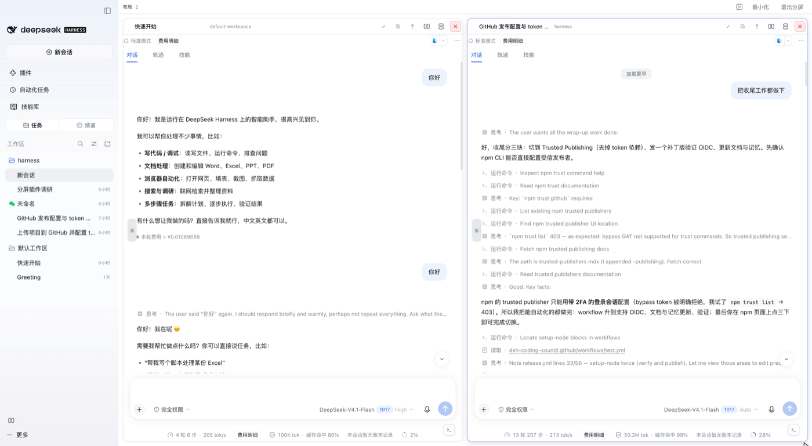
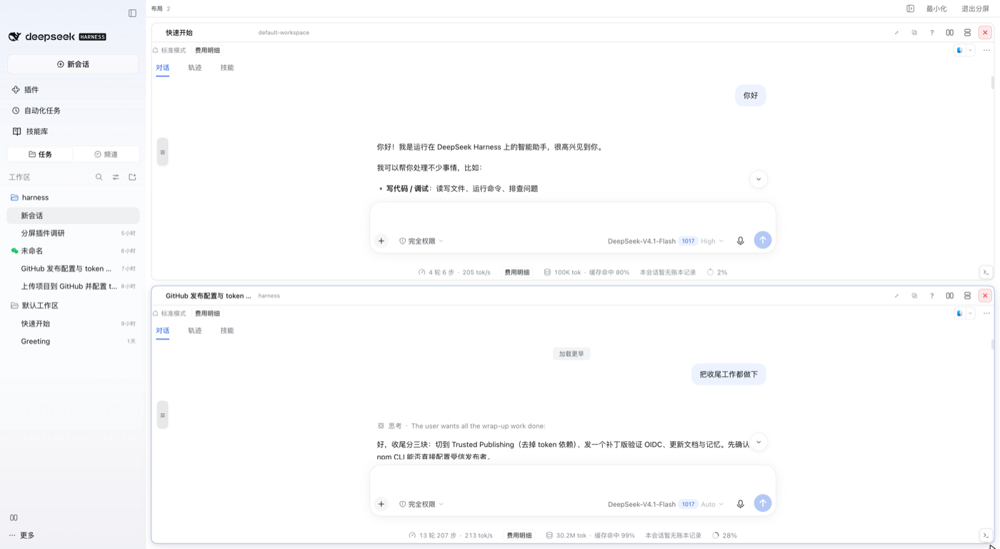
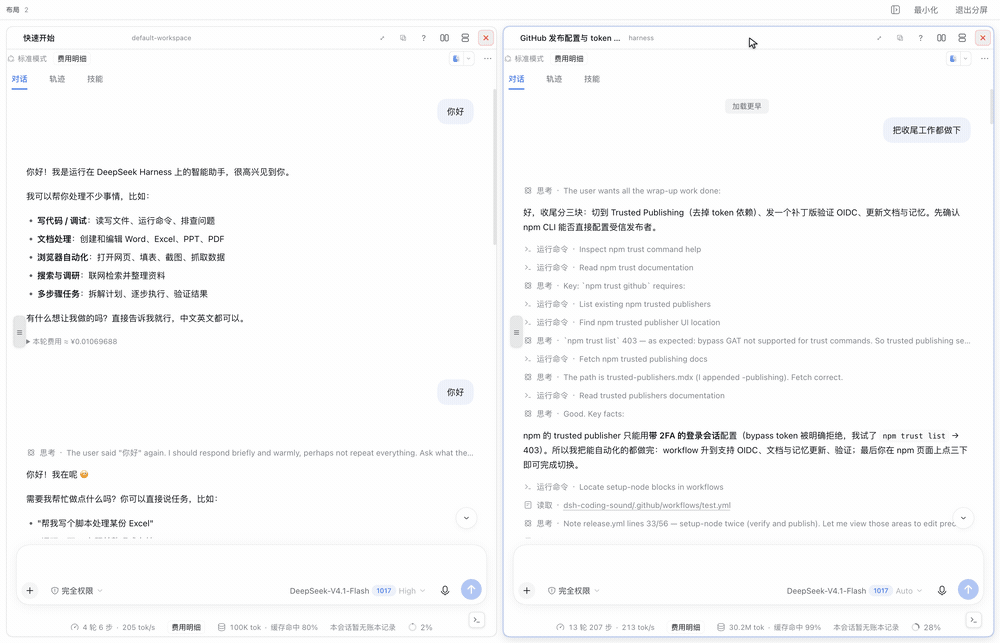

# dsh-split-workspace

**中文（默认）** · [English](#english)

把 DeepSeek Harness 的对话区拆成原生多窗格工作区——左右分屏、上下分屏、田字 2×2 或自动网格，窗口放得下多少会话就开多少。每个窗格都是真实会话，拥有自己的输入框、流式输出、停止、队列、待办、附件、`/` 命令、`ask_user_question`、审批与视图页，桌面端（`dsh-app://`）同样可用。还可以把任意会话变成可拖动、可缩放的**浮窗**，在分屏与浮窗两种模式之间来回切换。

## 快速开始

### 先选运行方式

| 方式 | 适用场景 | 插件安装位置 |
| --- | --- | --- |
| Web（`dsh web`，浏览器打开） | 先在浏览器里试用、远程机器 | `web` profile |
| 桌面端 DSH Desktop（`dsh-app://`） | 日常使用，支持完整桌面能力，推荐 | `desktop` profile，由桌面端管理 |

- 支持 DSH 0.2.0 / 0.2.1，当前针对 0.2.1-rc.2 构建。
- 包内 `lib/client.js` 已预构建，无原生依赖、无安装脚本；macOS / Windows / Linux 行为一致。
- 插件本身运行时不联网。

### Web：在线安装

```sh
dsh plugin --profile web add dsh-split-workspace
dsh --profile web
```

`dsh --profile web` 会启动 Web 服务并打印带 token 的地址；如果服务已在运行，安装后重启它，再硬刷新页面。

### Web：离线安装

在联网机器上打包，或从 GitHub Release 下载 `.tgz`，然后拷到目标机器：

```sh
# 联网机器
npm pack dsh-split-workspace

# 目标机器：.tgz 绝对路径
dsh plugin --profile web add /absolute/path/dsh-split-workspace-<version>.tgz

# 或者解压后安装目录
dsh plugin --profile web add /absolute/path/dsh-split-workspace
dsh --profile web
```

- 只有源码 ZIP 时，先解压；发布包已包含 `lib/client.js`，通常不需要再构建。仓库根目录必须能直接看到 `package.json`。
- 目标机器不需要访问 npm，也不需要访问 GitHub。

### Desktop：在线安装

1. 打开 DSH Desktop，侧边栏 **插件市场**，搜索 `dsh-split-workspace` 并安装；或进入 **插件 → 添加插件 → 安装第三方插件**，填入包名。
2. 打开 **设置 → 插件**，启用 `dsh-split-workspace`。
3. 安装完成后插件通常会被 DSH 的 HMR 立即加载，无需重启；如果几秒后侧边栏底部仍没有分屏图标，再完全退出并重开 DSH Desktop（插件加载后，菜单/更新提示也提供「重启 DSH」入口）。

> 桌面端的 `desktop` profile 由 Electron 应用独占管理。不要在终端执行 `dsh plugin --profile desktop add ...`，该命令会拒绝执行；桌面端请用上面的插件市场 / 添加插件界面。

### Desktop：离线安装

1. 在联网机器执行 `npm pack dsh-split-workspace`，或从 Release 下载 `.tgz`，拷到目标机器。
2. DSH Desktop → **插件 → 添加插件 → 安装第三方插件**：
   - 优先填 `.tgz` 的**绝对路径**（安装器会识别为「压缩包」）；
   - 如果当前版本只接受目录，先把 `.tgz` 解压，再填解压后的目录路径（目录根下要有 `package.json`）。
3. 在 **设置 → 插件** 启用；通常会被 HMR 立即加载。若侧边栏底部没有出现分屏图标，完全退出并重开 DSH Desktop，或使用插件菜单里的「重启 DSH」。
4. 离线机器不需要网络；插件运行时不联网。

### 启用与验证

- 打开 **设置 → 插件**，确认 `dsh-split-workspace` 已启用。DSH 0.2.x 会通过 HMR 热加载新安装的插件；如果没有出现界面，见下方「更新、重载与重启」。
- 分屏入口：点击侧边栏底部（设置旁）的分屏图标，或把侧边栏里的会话拖到对话区。
- 打开浏览器/桌面端控制台执行 `window.__dshSplitWorkspace.health()`，可看到版本、窗格数和几何状态。
- 如果看不到分屏入口：确认插件已启用且没有报错；如果侧边栏底部的 footer 没有渲染，插件会在对话区左下角显示兜底的分屏按钮。

### 开始分屏

- 点击侧边栏底部的分屏图标会弹出分屏菜单：**添加分屏 / 退出分屏 / 最小化分屏 / 重置分屏**。
- **添加分屏** 会打开多选弹框；勾选两个或更多会话后点确定即可分屏。已经处于分屏时弹框会默认勾选当前窗格的会话，可以取消勾选来移除窗格，也可以继续添加新会话，最终按勾选结果重新分屏。
- 也可以直接在会话列表里操作：右键会话（或点行尾的「⋯」）→ **加入分屏** / **退出分屏**。还没进入分屏时，第一次「加入分屏」会先放进**待分屏**，再加一个会话才会真正进入分屏；已经在分屏时则直接加入当前分屏。反向「退出分屏」会把该会话移出分屏，只剩一个会话时自动退出分屏。
- 或者把侧边栏里的会话拖到对话区：放下的会话成为第二个窗格。
- 分屏后，把另一个会话拖到某个窗格即可替换；也可以用窗格标题栏的分屏按钮为新窗格选择会话。
- 拖动侧边栏会话经过窗格边缘时，窗格会预览放下后的布局，并用虚线占位标出即将加入的会话；松开即应用该布局。
- **重置分屏** 会清空本插件在 localStorage / sessionStorage 里的分屏相关键、已保存布局、崩溃保护、最小化标记和窗格临时缓存（性能模式偏好会保留）；当分屏因为缓存或异常状态怎么都起不来时，点它即可恢复到干净状态。
- 右键任意会话（或点行尾的「⋯」）→ **进入浮窗**，即可把该会话变成一个可自由摆放的浮窗；浮窗标题栏可以拖动、边缘可以缩放，点 **⇲ 回到分屏** 放回分屏，点 **✕** 直接关闭浮窗。同一会话不会同时出现在分屏和浮窗里：进入浮窗时会自动从分屏/待分屏中移出。
- 右键会话 → **在系统窗口打开**：在系统默认浏览器里打开一个只显示该会话的独立窗口，关闭 / 最小化 / 双击标题栏放大 / 全屏都由系统窗口原生提供。
- **关闭窗格（标题栏 ✕）或退出分屏时，只要剩余会话少于两个就整体退出分屏**：窗格树和所有会话的分屏状态会一起清空，不会留下「菜单里显示分屏中、却没有被选中」的残留状态。只剩一个窗格的分屏不成立，所以不保留隐藏的单窗格树。

## 浮窗模式（独立窗口）

分屏和浮窗是同一个工作区的两种形态，可以随时互相切换：

- **分屏 → 浮窗**：右键会话 → **进入浮窗**。该会话会从分屏（或待分屏）中移出，变成一个浮动窗口；窗口内仍然是这个会话的真实原生界面（输入框、流式输出、停止、队列、工具行、附件、审批、视图页都可用）。
- **浮窗 → 分屏**：右键浮窗里的会话 → **加入分屏**（或标题栏的 **⇲ 回到分屏**）。若当前已有分屏，会话直接追加为窗格；若还没有分屏，会先进入「待分屏」，再加一个会话即开始分屏；右键 → **退出浮窗** 只关闭浮窗，不放回分屏。
- **浮窗操作**：拖动标题栏移动窗口，拖动任意边缘/角落缩放，点击窗口自动置顶；位置、大小和层叠顺序会持久化，DSH 重启后浮窗仍在。窗口缩放或右侧栏开合后，浮窗会自动回到可见范围。
- **与分屏共存**：浮窗可以浮在分屏之上，每个浮窗独立占用一个真实会话；从 2 窗格分屏抽出一个会话会结束分屏并清除另一个会话的分屏状态（浮窗 ⇲ 回分屏时进入「待分屏」，再加一个会话即可重新分屏）；3 个及以上窗格抽取时，分屏继续显示剩余窗格。
- 浮窗和分屏窗格互斥：一个会话只会存在一种形态，避免同一会话被两个输入框同时编辑。

### 为什么浮窗不是系统级独立窗口？

这不是偷懒，而是当前 DSH 宿主没有提供第二个原生窗口：

- DSH Desktop 的 Electron 主进程只创建一个主窗口；主窗口的 `setWindowOpenHandler` 对 `window.open` 一律返回 `{ action: "deny" }`（仅把 http/https 链接交给系统浏览器打开），也没有按会话开窗的 IPC 或菜单项。
- DSH Web 客户端是单页应用，没有 `?session=` 之类的会话深链路由；会话切换由 `uiWorkspace.openSession` 在页面内完成，不存在“打开一个只显示某会话的新窗口”的 URL。
- 插件运行在渲染层，无法创建 Electron `BrowserWindow`；因此浮窗实现为 `shell.overlay` 之上的**应用内窗口**：它可以移动、缩放、置顶、持久化，并且宿主是真实的 `ChatPane`，但与主窗口共享同一个客户端和页面。

如果 DSH 未来开放原生多窗口能力，浮窗层可以直接换成原生窗口，而“分屏 ⇄ 浮窗”的会话切换逻辑不需要改。

## 系统窗口（独立窗口）

- 右键会话 → **在系统窗口打开**：插件通过宿主生成已认证的 DSH Web 地址，并在**系统默认浏览器**中打开一个新窗口；窗口里只渲染这个会话（DSH 侧栏等界面被隐藏），关闭、最小化、双击标题栏放大、全屏都由系统窗口原生提供。
- 打开时该会话会从分屏 / 浮窗 / 待分屏中移出，避免同一会话同时被两个输入框编辑；关闭系统窗口不会删除会话，它仍在侧栏里，可随时重新加入分屏。
- 窗口页头双击可进入 / 退出页面全屏（页头的 ⛶ 按钮相同）；窗口标题会同步会话标题。
- **为什么是浏览器窗口？** DSH Desktop 的 Electron 主进程只保留一个应用窗口，主窗口的 `setWindowOpenHandler` 拒绝用 `window.open` 创建第二个原生窗口（http/https 只交给系统浏览器）；插件的 Host 进程是 Node 子进程，没有 Electron `BrowserWindow` API。因此当前 DSH 版本下，能真正位于 DSH 工作区之外、并具备系统窗口控制的方案就是由操作系统打开一个浏览器窗口。Web 版由 `window.open` 直接打开同样的独立窗口。
- 限制：窗口带浏览器地址栏 / 标签页 UI，不是 DSH 原生第二窗口；如果未来 DSH 开放原生多窗口，这一层可以替换。

## 性能模式与卡顿排查

**性能模式默认开启**（从 0.9.0 起；显式关过一次的保留关闭状态）。在侧边栏底部分屏按钮的菜单里点 **性能模式** 可切换（也可用 `window.__dshSplitWorkspace.setPerformanceMode(true/false)`，设置会持久化）。开启后：

- 关闭所有窗格 / 浮窗 / 菜单 / 提示的动画、过渡、卡片阴影和焦点光晕，并停掉工具行跑马灯动画。
- 关闭**每个窗格的 composer 几何测量 MutationObserver**。这是最可疑的开销之一：流式输出每个 token 都会改动窗格 DOM，旧逻辑会在每次改动时排队测量（`getBoundingClientRect` + 样式读取），窗格越多越明显；性能模式改为 ResizeObserver + 1.5s 轮询。
- 暂停 TOC 握把同步（`dsh-prompt-history` 的 ☰ 定位）、压缩结果监听、浮窗位置巡检、右侧栏 800ms 轮询（保留 resize 监听），几何测量从 1s 降到 3.5s，侧栏会话扫描从 200ms 降到 1s。
- 拖动会话/窗格时**完全不渲染缩略图预览**（不克隆对话 DOM，也没有逐帧移动的预览窗口）；拖入目标、布局预览和放置反馈仍然保留。
- 真实会话、输入、停止、审批、分屏 / 浮窗 / 系统窗口功能全部保留。

**仍然可能卡的原因**：每个窗格都是一个完整的原生对话视图，N 个会话同时流式输出就是 N 份 React/DOM 渲染与滚动更新，这是 DSH 客户端本身的主要成本，插件无法消除（除非上游支持离屏暂停/虚拟化）。在 Windows + 低单核性能的机器上，建议同时保持 2–3 个活动窗格、少开浮窗、把不用的分屏最小化；输入框可切到紧凑 TUI 模式；如果装了 `dsh-prompt-history`，它的 TOC 同步在性能模式下会被暂停。

诊断入口：`window.__dshSplitWorkspace.health()` 查看 `performance`、`panes`、`geometry`、`active`；用 DevTools Performance 对比开启性能模式前后的长任务。

## 更新、重载与重启

DSH 0.2.x（含 Desktop 0.2.2-rc.3）带 HMR：新安装的插件会被热加载，重建后的客户端 bundle 也会自动替换，**大多数安装/更新不需要重启 DSH**。以下情况才需要重启：

- 插件管理器明确提示 `restart-required`（Host 半边、被链接包的宿主模块发生变化，或包目录被移动）；
- 安装后侧边栏底部几秒内没有出现分屏图标（少数没有 HMR 的旧版 DSH）。

DSH **生产版没有内置的“重启”菜单项**（开发版才有 `Restart App and Host`）。从本插件的 0.9.0 起：

- 侧边栏底部 **分屏菜单 → 重启 DSH**：先确认（运行中的任务会中断），再由 Host 半调用系统级“退出并重新打开”（macOS 通过 AppleScript 正常退出，Windows 关闭窗口后终止进程并重启）。
- 检测到磁盘版本比页面新时，右下角的更新提示直接提供 **重启 DSH** 按钮；Web 版提供 **刷新页面**。
- 也可以用 `window.__dshSplitWorkspace.restartApp()`，或按老办法手动退出后重新打开：Windows 从托盘/开始菜单彻底退出，macOS 用 ⌘Q。
- 底部菜单的 **刷新界面** 只重新加载页面（适合浮层卡住、布局异常），不会应用需要重启的 Host 变化。
- 首次安装时插件客户端可能尚未加载，因此插件自身无法显示重启按钮；插件管理器会在安装结果里提示重启，按提示或手动退出重开即可。
- **安装后看不到分屏入口时，先尝试刷新页面而不是重启**：DSH Desktop 生产版没有页面刷新菜单，但自带 **开发者工具**（macOS `⌘⌥I`，Windows `Ctrl+Shift+I`，或菜单 View → Toggle Developer Tools）；在开发者工具里点刷新按钮、按 `⌘R` / `F5`，或在 Console 执行 `location.reload()`，都会重新加载页面并取回最新的插件图，通常无需重启 DSH。仍不生效再完全退出重开。

## 功能

- **侧边栏分屏菜单**：底部分屏按钮弹出「添加分屏 / 退出分屏 / 最小化分屏 / 重置分屏」，其中退出和最小化与顶部工具栏完全一致。
- **多选添加分屏**：弹框可搜索、可多选；已分屏时默认勾选当前窗格，可取消或追加，按最终勾选结果分屏。
- **会话右键集成**：原生右键菜单新增「加入分屏 / 退出分屏」，未分屏时先进入待分屏，满两个才分屏；退出到只剩一个自动退出分屏。
- **浮窗模式**：右键会话 → 「进入浮窗」，把会话变成可拖动、可缩放的独立窗口；标题栏 ⇲ 放回分屏、✕ 关闭，浮窗位置/大小/层叠顺序持久化。
- **分屏 ⇄ 浮窗双向切换**：同一会话互斥存在于一种形态；进入浮窗自动移出分屏，回到分屏自动关闭浮窗。
- **系统窗口**：右键会话 → 「在系统窗口打开」，在系统默认浏览器中打开只含该会话的独立窗口；原生关闭 / 最小化 / 最大化 / 全屏，打开时自动从分屏和浮窗移出。
- **性能模式（默认开启）**：一键关闭动画、阴影、跑马灯和多个后台轮询/观察器，适合低配或 Windows 上多窗格卡顿的场景；设置持久化。性能模式下**不再渲染拖动会话时的缩略图预览**（拖入目标与放置反馈保留），可以再明显减少拖动时的 DOM/合成开销。
- **更新提示 / 重启 DSH / 刷新界面**：检测到磁盘上的新版本时右下角提示，并提供「重启 DSH」（桌面版）或「刷新页面」（Web 版）；分屏菜单同时提供「刷新界面」与「重启 DSH」。
- **兜底分屏入口**：如果所在 DSH 布局没有渲染侧边栏 footer（或 footer 被隐藏），插件会在对话区左下角显示一个分屏按钮，保证菜单仍可打开。
- **一键重置**：清空插件相关的 localStorage / sessionStorage、布局、崩溃保护和临时缓存，避免异常状态卡住分屏。
- **不限数量的原生窗格**：没有四窗格上限，窗口放得下多少会话就能开多少。
- **自动布局**：2 个窗格左右分栏，3 个呈 L 形，4 个田字 2×2，5 个以上按行优先的均衡网格排列。
- **拖拽自由排布**：拖动窗格标题栏到另一个窗格的左/右/上/下，可手动堆叠或分栏。
- **原生会话，不是 iframe**：每个窗格复用原生会话组件，输入框、流式输出、停止、队列、待办、审批和视图页都能正常工作。
- **桌面端就绪**：为 DSH Desktop（`dsh-app://`）构建，preload 只在顶层框架运行。
- **共享侧边栏**：原生侧边栏跟随当前聚焦的窗格；把会话拖到分屏区域即可新增或替换窗格。
- **右侧栏控制**：打开/关闭有不同图标状态，由分屏工具栏统一控制。
- **最小化 / 恢复**：隐藏分屏但保留窗格树。
- **持久化布局**：重启后恢复上次的布局。

## 布局

- 自动策略：2 个并排，3 个 L 形，4 个 2×2，5 个以上按约 `sqrt(n)` 列的均衡行优先网格。没有模式菜单——增删窗格都会重新适配网格。想要上下堆叠，把第二个窗格的标题拖到第一个上，再移到底部边缘；手动拖拽的结果会被保留，自动网格只是起点。
- 拖动分隔条调整大小。
- 拖动标题栏移动窗格：原位置立即闭合（其他窗格填充空间），并在将落下的位置出现虚线占位——左、右、上、下，跟随手势方向。松开即放下；松开在原来的位置或按 `Esc` 取消。预览只计算几何，不重新挂载正在运行的会话。
- 双击标题栏（或 `⤢` 按钮）最大化/还原。
- 没有固定窗格上限：窗口能显示多少会话就能加多少（窗格变窄时标题栏会自动紧凑）。
- 存在分屏时，共享的原生侧边栏跟随聚焦窗格；点击会话即载入该窗格，或把会话拖到分屏区域新增/替换窗格。
- 窗格树在刷新和重启后保留（包括手工拖出的堆叠或 L 形布局）；增删窗格会重新适配自动网格，重启不会。
- **最小化**（工具栏）会隐藏分屏、显示原生单会话视图，同时保留窗格树；「恢复分屏」按钮可以恢复。点击**新建会话**或插件/技能/设置面板会自动最小化分屏（新视图不会被遮挡）；恢复后回到聚焦窗格的会话。
- 每个窗格只有一个标题：标题由窗格标题栏负责；原生标题栏保留视图页和操作，不重复面包屑。关闭按钮是红底描边的 **✕**，不是低对比度圆点。
- 如果安装了 `dsh-prompt-history`，它的可拖动 **会话目录 (☰)** 握把会在每个活动窗格的左边缘垂直居中显示一次。每次分屏调整（新增、关闭、重排、拖动分隔条、最大化或右侧栏推挤）都会把受影响的握把重新放回窗格左边缘与垂直中心；没有变化的窗格保留手动拖动的位置。隐藏的原生会话和非窗格视图里的副本会被隐藏，握把不再堆叠。
- 分屏工具栏的右侧栏按钮有**两种状态**：面板关闭时是右箭头（点击打开），打开时是高亮的左箭头（点击收起）。修复监听器会在分屏拆除后接管原生的打开/收起按钮，避免过期的 sidebar-right store 吞掉点击或隐藏入口。
- 窗格标题栏刻意**不**挂载原生的每窗格 rightbar 座位（右侧栏由分屏工具栏统一控制）。该座位是会话级的，自带 store 句柄；在每个窗格里挂载会为同一会话创建第二个 sidebar-right store，导致共享面板的标签图标看起来失效。原生标题栏保留唯一的 store。

## 为什么不是每个窗格一个 iframe？

桌面端从 `dsh-app://app/` 提供客户端，并通过 Electron preload 注入启动图（`__DSH_BOOT__`、`__DSH_TRANSPORT__` 等）。preload 只在顶层框架运行，所以同源 iframe 会永远停在 “Loading plugins…”。因此窗格引擎在**顶层客户端**运行，按会话重新挂载原生对话组件——与上游插件相同的架构。

## 命令

- `window.__dshSplitWorkspace.health()`：版本、宿主、窗格、几何、持久化树、崩溃保护。
- `window.__dshSplitWorkspace.split(sessionId)`：把会话加为窗格。
- `window.__dshSplitWorkspace.addToSplit(sessionId)` / `removeFromSplit(sessionId)`：加入 / 退出分屏（未分屏时先进入待分屏）。
- `window.__dshSplitWorkspace.float(sessionId)`：把会话变成浮窗（自动从分屏/待分屏移出）。
- `window.__dshSplitWorkspace.dockFloat(sessionId)`：把浮窗放回分屏（没有分屏时进入待分屏）。
- `window.__dshSplitWorkspace.closeFloat(sessionId)`：关闭浮窗（不放回分屏）。
- `window.__dshSplitWorkspace.floats()`：当前浮窗的会话 id 列表（按创建顺序）。
- `window.__dshSplitWorkspace.openSystemWindow(sessionId)`：在系统窗口打开该会话（宿主生成已认证 URL）。
- `window.__dshSplitWorkspace.setPerformanceMode(true/false)`：开关性能模式（持久化）。
- `window.__dshSplitWorkspace.performanceMode()`：当前是否处于性能模式。
- `window.__dshSplitWorkspace.reloadClient()`：刷新页面。
- `window.__dshSplitWorkspace.restartApp()`：退出并重新打开 DSH 桌面版（需要完整重启时使用）。
- `window.__dshSplitWorkspace.pending()`：当前待分屏的会话 id。
- `window.__dshSplitWorkspace.openAddSplitDialog()`：打开多选添加分屏弹框。
- `window.__dshSplitWorkspace.arrange("auto")`：重新适配自动布局（旧模式名会被接受并忽略）。
- `window.__dshSplitWorkspace.focusChat()`、`closeFocused()`。
- `window.__dshSplitWorkspace.reflow()`：拖动预览状态（排查占位/闭合行为用）。
- `window.__dshSplitWorkspace.setEnabled(false)`：总开关。
- `window.__dshSplitWorkspace.reset()`：清除已保存布局。
- `window.__dshSplitWorkspace.resetAll()`：连同 localStorage / sessionStorage 与临时缓存一起彻底重置（等同菜单里的「重置分屏」）。

## 工程结构（源码拆分）

`lib/client.js` 是**构建产物**，不要直接编辑；源码在 `src/client/`，按模块拆成 18 个有序片段，由 `scripts/build-client.mjs` 拼回单文件：

| 片段 | 内容 |
| --- | --- |
| `00-preamble` / `01-constants` | module-loader 入口、React/P、常量、存储、性能/版本键、独立窗口检测 |
| `02-styles` | 全部 `dsv-*` CSS（含性能模式与浮窗样式） |
| `03-runtime` | runtime store、健康诊断、会话列表源 |
| `04-tree` | 分屏树 store、布局算法、持久化 |
| `05-pending-float-store` | 待分屏状态、浮窗 store 与模式切换 |
| `06-drag-reflow` | 窗格拖动预览/reflow、拖拽工具 |
| `07-faces` | root standard faces、session bindings |
| `08-pane-kit` | slot 捕获与原生组件 re-host |
| `09-pane-renderers` | 原生/降级对话与输入框渲染器 |
| `10-pane-frame` | 窗格标题栏、关闭/浮窗按钮、composer 测量 |
| `11-canvas-navigation` | 画布/分隔条、会话选择器、键盘导航、公共 API 前置 |
| `12-chrome` | 安全模式/帮助/提示、性能模式提示、更新通知、座位 |
| `13-drag-bridge` | 未激活时的拖入分屏桥 |
| `14-launcher` | 底部菜单、多选添加分屏弹框、会话菜单集成 |
| `15-float-window` | 浮窗组件与图层 |
| `16-standalone` | 系统窗口独立页 |
| `17-api-apply` | `window.__dshSplitWorkspace` API、`apply()` 与导出 |

- `npm run build`：重新生成 `lib/client.js`；`npm test` 会先跑 `build:check`，源码/产物不一致会失败。
- 为什么不用打包器：DSH 客户端只加载一个 `<plugin>/client.js`，片段共享同一个 module-loader 闭包，按顺序拼接即可；这样发布包保持零依赖、无构建依赖。
- 修改代码时改 `src/client/` 对应片段，然后 `npm run build`；`lib/client.js` 顶部有一行 GENERATED 标记。

## 快捷键

- `Alt+T`：切换聚焦窗格里的紧凑 TUI 输入框。
- `Alt+Shift+←/→/↑/↓`：在窗格间移动焦点。

## 界面截图

| 左右两列 · Side by side | 上下两列 · Stacked | 田字 · 2×2 grid |
| :-: | :-: | :-: |
| [](https://raw.githubusercontent.com/mhlywxl/dsh-split-workspace/main/docs/screenshots/layout-side-by-side.png) | [](https://raw.githubusercontent.com/mhlywxl/dsh-split-workspace/main/docs/screenshots/layout-stacked.png) | [](https://raw.githubusercontent.com/mhlywxl/dsh-split-workspace/main/docs/screenshots/layout-grid-2x2.png) |
| 2 panes · automatic columns | 2 panes · dragged into rows | 4 panes · automatic 2×2 田字 |

Drag a pane by its header to re-arrange it — the dashed hole previews where it
will land:



## 限制

- 没有窗格数量上限；持久化树会校验（会话唯一、深度），损坏的树会被丢弃，而不是恢复一个坏掉的工作区。
- 「浮窗」是应用内窗口，不是 Electron 原生第二窗口：DSH Desktop 主窗口禁用了 `window.open`，Web 客户端也没有会话深链；浮窗复用真实会话组件、可拖动缩放，但仍在 DSH 主窗口内渲染（详见上面的「为什么浮窗不是系统级独立窗口？」）。
- 浮窗和分屏窗格互斥；同一会话不会同时以两种形态渲染，避免共享编辑器冲突。
- 「系统窗口」当前由系统默认浏览器承载（DSH Desktop 拒绝插件创建第二个原生窗口，Host 进程也没有 Electron 窗口 API），因此带浏览器地址栏；系统窗口内的会话同样互斥于分屏和浮窗。
- 持久化递归深度上限为 32 层，是为了手改数据时的栈安全，不是窗格上限。
- 隐藏的原生会话仍在遮罩下流式运行；窗格重新挂载原生输入框，所以每个窗格自己的输入框拥有该会话的编辑器。
- 窗格重命名拒绝空会话（原生重命名对话框同样如此）。
- 输入框增强插件兼容：分屏只让当前聚焦的窗格保留 `data-composer-card`，隐藏的原始输入框和非聚焦窗格不会抢走全局选择器；每个窗格仍挂载自己的输入浮层，切换窗格时非聚焦窗格的浮层隐藏但状态保留。`dsh-tweaks-prompt-history` 的历史角标、`dsh-prompt-history` 的候选提示、斜杠/模型菜单因此都定位在当前窗格。
- 拖动窗格时预览直接吸附，不再对宽度/高度做 180ms 过渡；拖动期间冻结窗格的尺寸观察和输入框测量，避免每个预览帧重排整段对话。
- 页面单例型输入增强插件（如 `dsh-prompt-history`）按活跃窗格隔离：预测上下文只读活跃窗格的对话行，隐藏的原始页不再抢输入焦点；非活跃窗格的草稿被外部写入时会回滚，Tab/→ 只把预测写入当前窗格。

MIT。见 `THIRD-PARTY-NOTICES.md`。

---

## English

**Split screen for DeepSeek Harness (DSH) Desktop — open as many conversations
as you need, side by side, stacked, or in a 2×2 / automatic grid.** Any
conversation can also become a movable, resizable **floating window**, and the
two modes switch back and forth at any time.

`dsh-split-workspace` turns the DeepSeek Harness conversation area into a native
multi-pane workspace, including in the **Desktop app** (`dsh-app://` shell). Each
pane is a real session with its own composer, streaming, Stop, queue, todos,
attachments, `/` commands, `ask_user_question`, approvals and view tabs.

**中文简介**：把 DeepSeek Harness 的对话区拆成任意数量的原生窗格，支持左右分屏、
上下分屏、田字 2×2 和自动网格；每个窗格都是真实会话，拥有自己的输入框、流式输出、
停止、队列、待办、附件、斜杠命令、审批和视图页。适用于 DSH 桌面端。

**Search terms / 搜索关键词**：split screen, split view, split pane, multi-pane,
multi-session, multi-window, tiled workspace, unlimited panes, DSH Desktop,
分屏, 分屏插件, 多窗格, 多窗口, 多会话, 左右分屏, 上下分屏, 并排, 田字布局.

The pane engine is derived from
[dsh-split-screen](https://github.com/YEYEYEYESHIFU/dsh-split-screen) 1.7.0
(MIT). This package adapts it for the Desktop shell and adds the automatic
layout, the unlimited pane count, rename/copy/maximize and the compact toolbar.

### Quick start

**Pick where to run it**

| Mode | Best for | Plugin profile |
| --- | --- | --- |
| Web (`dsh web`, browser) | Trying it in a browser or on a remote machine | `web` |
| DSH Desktop (`dsh-app://`) | Daily use with full desktop features (recommended) | `desktop`, managed by the app |

- DSH 0.2.0 / 0.2.1 are supported; this build targets 0.2.1-rc.2.
- The package ships a prebuilt `lib/client.js`, has no native modules and no install scripts, and is identical on macOS / Windows / Linux.
- The plugin itself makes no network requests at runtime.

**Web: online install**

```sh
dsh plugin --profile web add dsh-split-workspace
dsh --profile web
```

`dsh --profile web` prints the tokenized URL. If the server is already running, restart it after installing and hard-refresh the page.

**Web: offline install**

Pack on a connected machine (or download the `.tgz` from a GitHub Release), copy it to the target, then:

```sh
npm pack dsh-split-workspace                      # connected machine

dsh plugin --profile web add /absolute/path/dsh-split-workspace-<version>.tgz
# or, after extracting:
dsh plugin --profile web add /absolute/path/dsh-split-workspace
dsh --profile web
```

- For a source ZIP, extract it first; the package root must contain `package.json` (release tarballs already include `lib/client.js`).
- The target machine needs neither npm nor GitHub access.

**Desktop: online install**

1. Open DSH Desktop → **Plugin market** in the sidebar, search for `dsh-split-workspace`, and install it. Or use **Plugins → Add plugin → Install a third-party plugin** and enter the package name.
2. Open **Settings → Plugins** and enable `dsh-split-workspace`.
3. DSH's HMR normally loads a newly installed plugin immediately, so no restart is needed. If the split icon still does not appear in the sidebar footer after a few seconds, quit and reopen DSH Desktop completely (the plugin menu and update chip also offer **Restart DSH**).

> The `desktop` profile is owned by the Electron app. Do **not** run `dsh plugin --profile desktop add ...` in a terminal; it is rejected. Use the in-app plugin market / Add plugin UI instead.

**Desktop: offline install**

1. On a connected machine run `npm pack dsh-split-workspace`, or download the `.tgz` from a Release, and copy it to the target.
2. DSH Desktop → **Plugins → Add plugin → Install a third-party plugin**:
   - prefer the **absolute path to the `.tgz`** (the installer recognises it as a tarball);
   - if that build only accepts directories, extract the `.tgz` and enter the extracted directory (its root must contain `package.json`).
3. Enable it in **Settings → Plugins**; HMR usually loads it immediately. If the footer split icon does not appear, quit and reopen DSH Desktop, or use **Restart DSH** in the plugin menu.
4. The offline machine needs no network access; the plugin makes no runtime requests.

**Enable and verify**

- **Settings → Plugins** must show `dsh-split-workspace` enabled. DSH 0.2.x hot-loads newly installed plugins through HMR; if the UI still does not appear, see “Updates, reload and restart”.
- Entry points: the split icon in the sidebar footer (beside Settings), or drag a conversation from the sidebar onto the conversation column.
- Run `window.__dshSplitWorkspace.health()` in the browser/desktop console to see the version, pane count and geometry.
- If the split entry is missing: make sure the plugin is enabled and has no error. When the stock sidebar footer does not render this plugin's action, the plugin shows a fallback split button at the conversation area's bottom-left corner.

**Start splitting**

- Click the split icon in the sidebar footer (beside Settings) to open the split menu: **Add split / Exit split / Minimize / Reset split**.
- **Add split** opens a multi-select dialog. Check two or more conversations and confirm. While already split, the dialog pre-selects the current panes: uncheck one to remove its pane, check more to extend, and the final selection becomes the split.
- You can also use the session list: right-click a conversation (or its row `⋯` button) and pick **Add to split** / **Leave split**. Outside split mode the first pick is parked as a *pending split*; adding a second conversation starts the split. Inside split mode the conversation joins the current split immediately. Leaving removes it, and dropping to one conversation exits split mode.
- Or drag a conversation from the sidebar onto the conversation column: the dropped conversation becomes the second pane.
- Once split, drag another conversation onto a pane to replace it, or use a pane header's split buttons to choose the session for a new pane.
- While a sidebar conversation is dragged over a pane edge, the panes lay themselves out as they will after the drop and a dashed placeholder names the incoming conversation — release to commit exactly that layout.
- **Reset split** clears the plugin's split-related localStorage / sessionStorage keys, the saved layout, the crash guard, the minimized flag and pane caches, so a split stuck by stale state can always start again (the performance-mode preference is kept).
- Closing a pane (header **✕**) or leaving the split via the context menu exits the split as soon as fewer than two conversations remain: the whole pane tree and every conversation's split membership are cleared, so nothing is left tagged “in split” while unselected.
- Right-click any conversation (or its row `⋯` button) → **Enter floating window** to detach it into a movable window. Drag its title bar to move it, drag any edge to resize, use **⇲ Dock to split** to put it back into a split, or **✕** to close the float. A conversation is never hosted in both modes: entering a float removes it from the split / pending split first.
- Right-click a conversation → **Open in system window** to open it alone in a separate system window (the default browser on Desktop), with the window's native close / minimize / maximize / fullscreen controls.

### Floating windows

Split panes and floating windows are two shapes of the same workspace, and a
conversation can switch between them without a reload:

- **Split → float**: right-click a conversation → **Enter floating window**. It
  leaves the split (or the pending pick) and becomes a floating window that
  hosts the session's real native UI — composer, streaming, Stop, queue, tool
  rows, attachments, approvals and view tabs all keep working.
- **Float → split**: right-click the conversation inside the float → **Add to
  split** (or use the header's **⇲ Dock to split**). With a split running, the
  session is appended as a pane; with none, it is parked in the pending split
  and the next pick starts the split. **Exit floating window** only closes the
  float without docking it.
- **Window behaviour**: drag the title bar to move, drag any edge/corner to
  resize, click to raise. Position, size and stacking order persist across DSH
  restarts, and every float is clamped back into the conversation column after
  a window resize or a right-sidebar open/close.
- **With a split**: floats sit above the split. Extracting one conversation
  from a 2-pane split ends the split and clears the other conversation's split
  membership (docking the float back parks it in the pending split, so the next
  pick restarts the split); with 3+ panes the split keeps showing the remaining
  panes.
- A session exists in exactly one mode at a time, so two composers can never
  edit the same conversation at once.

#### Why not a real OS-level window?

This is a host limitation, not a shortcut:

- The DSH Desktop Electron main process creates a single main window; its
  `setWindowOpenHandler` returns `{ action: "deny" }` for every `window.open`
  (http/https links are handed to the system browser), and there is no
  per-session window IPC or menu action.
- The DSH Web client is a single-page app with no per-session deep link such as
  `?session=`; session switches happen in-page through `uiWorkspace.openSession`,
  so there is no URL for "open one conversation in a new window".
- A renderer plugin cannot create an Electron `BrowserWindow`.

The float is therefore an **in-app window** rendered on the `shell.overlay`
layer: movable, resizable, persistent, and backed by the real `ChatPane`, but
inside the same DSH page. If DSH later exposes native multi-window support, the
float layer can be swapped for real windows while the split⇄float switching
logic stays unchanged.

### System window

- Right-click a conversation → **Open in system window**: the Host plugin mints
  an authenticated DSH Web URL and opens it in a **separate system window**
  (the OS default browser on Desktop). The page renders that one conversation
  only; close / minimize / double-click-title-bar maximize / fullscreen are the
  native window's own controls.
- Opening it detaches the conversation from the split / float / pending pick, so
  one conversation is never edited through two composers. Closing the system
  window keeps the conversation — it stays in the sidebar and can rejoin a split.
- Double-click the page header (or use its ⛶ button) to toggle page fullscreen;
  the window title follows the conversation title.
- **Why a browser window?** The DSH Desktop Electron main process keeps a single
  application window and its `setWindowOpenHandler` refuses `window.open`
  (http/https is handed to the system browser); the plugin Host runs in a Node
  child process with no Electron `BrowserWindow` API. A browser window is
  therefore the only real OS window with native window controls that a plugin
  can open today. In Web mode `window.open` opens the same standalone window.
- Limitation: the window carries browser chrome (address bar / tabs); it is not
  a second DSH-native window. If DSH later exposes native multi-window support,
  this layer can be replaced.

### Performance mode and lag analysis

**Performance mode is ON by default** since 0.9.0 (an explicit off choice is
kept). Open the sidebar-footer split menu and pick **Performance mode**, or run
`window.__dshSplitWorkspace.setPerformanceMode(true/false)`; it persists. It
turns off:

- every pane / float / menu / chip animation, transition, card shadow, focus
  glow and running-row shimmer;
- the per-pane composer-geometry `MutationObserver`. This is the most suspicious
  cost: streaming mutates a pane's DOM on every token and the old path queued a
  measurement (`getBoundingClientRect` + style reads) for each change, multiplying
  with pane count. Performance mode keeps ResizeObserver plus a 1.5 s poll;
- TOC-grip sync (`dsh-prompt-history` ☰ placement), compaction-watch, float
  position polling and the 800 ms right-sidebar poll (resize listeners stay);
  geometry polling drops from 1 s to 3.5 s and sidebar session scraping from
  200 ms to 1 s;
- the floating drag-preview thumbnail for sessions and panes is not rendered at
  all — no DOM clone, no per-frame thumbnail positioning; drop targets and the
  layout reflow hole still work.

Real conversations, composers, approval flows, split/float/system-window
features all stay available.

**What can still lag**: every pane is a full native conversation view, so N panes
streaming at once means N independent React/DOM render and scroll pipelines —
the dominant upstream cost, which a renderer plugin cannot remove (that would
need upstream offscreen pausing/virtualization). On Windows machines with weak
single-core throughput, keep 2–3 active panes, close or minimize unused splits,
avoid stacking floats over a split, and use the compact TUI composer. Check
`window.__dshSplitWorkspace.health()` (`performance`, `panes`, `geometry`) and
compare DevTools Performance long tasks with the mode on/off.

### Updates, reload and restart

DSH 0.2.x (including Desktop 0.2.2-rc.3) ships HMR: a newly installed plugin is
hot-loaded, and a rebuilt client bundle is swapped into the open page. Most
installs/updates therefore need **no restart**. A restart is only needed when:

- the plugin manager reports `restart-required` (Host-half or linked-package
  host modules changed, or the package directory moved);
- the footer split icon still has not appeared a few seconds after install (some
  older DSH builds without HMR).

Production DSH has **no built-in Restart menu item** (development builds do).
Since dsh-split-workspace 0.9.0:

- **Split menu → Restart DSH** confirms first (running tasks are interrupted),
  then the Host half closes and reopens the desktop app at the OS level (a
  normal AppleScript quit on macOS; close-then-terminate and relaunch on
  Windows).
- The update chip offers **Restart DSH** on Desktop and **Reload page** in the
  Web GUI.
- `window.__dshSplitWorkspace.restartApp()` does the same. Manually: Windows —
  quit from the tray/Start menu; macOS — ⌘Q; then open DSH again.
- **Refresh interface** only reloads the page (useful for a stuck overlay or a
  layout glitch); it does not apply changes that need a full restart.
- On a first install the plugin client is not running yet, so it cannot show
  its own restart button; follow the plugin manager's restart notice or quit
  and reopen DSH manually.
- **If the split entry is missing after a hot install, try a page reload before a
  restart**: production DSH has no Reload menu item, but it ships Developer
  Tools (macOS `⌘⌥I`, Windows `Ctrl+Shift+I`, or View → Toggle Developer Tools).
  Use the reload button in Developer Tools, press `⌘R` / `F5`, or run
  `location.reload()` in its Console to reload the page and fetch the current
  plugin graph — usually no DSH restart is needed. Quit and reopen only if that still fails.

### Features

- **Sidebar split menu** — the footer button opens Add / Exit / Minimize / Reset; Exit and Minimize are the same actions as the split toolbar.
- **Multi-select add** — searchable dialog; pre-selects current panes, lets you uncheck or extend, and rebuilds the split from the final selection.
- **Session-menu integration** — the stock right-click menu gains Add to split / Leave split. Outside split mode the first pick waits in a pending split until a second conversation is added; removing down to one pane exits the split.
- **Floating windows** — right-click a conversation → Enter floating window turns it into a movable, resizable window; Dock to split / ✕ in its header switch it back or close it, and geometry persists.
- **Split ⇄ float switching** — one conversation lives in exactly one mode; entering a float detaches it from the split, docking it back closes the float.
- **System window** — right-click → Open in system window opens the conversation alone in a separate OS window (the default browser on Desktop) with native close / minimize / maximize / fullscreen; it is detached from split and float first.
- **Performance mode (on by default)** — one switch drops animations, shadows, shimmer and several background observers/polls for low-power or laggy Windows machines; the setting persists. In this mode the floating drag-preview thumbnail is not rendered at all (drop targets and placement feedback stay).
- **Update chip / Restart DSH / Refresh interface** — a newer on-disk version shows a corner chip with **Restart DSH** on Desktop or **Reload page** in the Web GUI; the split menu also offers Restart DSH and Refresh interface.
- **Fallback split entry** — when the host layout does not render the sidebar footer action (or hides it), the plugin shows a split button at the conversation area's bottom-left corner so the menu stays reachable.
- **One-click reset** — wipes plugin localStorage/sessionStorage, layout, crash guard and temporary caches.
- **Unlimited native panes** — no four-pane cap; add as many conversations as
  the window can show.
- **Automatic layout** — 2 panes as columns, 3 as an L, 4 as a 2×2 田字, and
  5+ as a balanced row-major grid.
- **Any arrangement by drag** — drag a pane header left, right, above or below
  another pane; stack a pair or build columns by hand.
- **Native sessions, not iframes** — each pane re-hosts the stock conversation
  primitives, so composer, streaming, Stop, queue, todos, approvals and view
  tabs all work.
- **Desktop-ready** — built for the DSH Desktop shell (`dsh-app://`), where the
  preload only runs in the top frame.
- **Shared sidebar** — the stock sidebar follows the focused pane; drag a
  conversation onto the split to add or replace a pane.
- **Right sidebar control** — open and close with distinct icon states; the
  split toolbar owns the toggle.
- **Minimize / restore** — hide the split without losing the pane tree.
- **Persistent tree** — the layout you left comes back after a restart.

### Layout

- The automatic policy: 2 panes side by side, 3 as an L, 4 as a 2×2 grid, and
  5+ as a balanced row-major grid that grows by about `sqrt(n)` columns. There
  is no mode menu — adding or closing a pane simply re-fits the grid. For a
  stacked pair, drag the second pane's header over the first, then move down
  to the bottom edge; a deliberate drag is kept, and the automatic grid is
  only the starting point.
- Drag the dividers to resize.
- Drag a pane by its header to move it: the pane's slot closes immediately (the
  other panes fill the space) and a dashed hole opens where it will land — left,
  right, above or below the pane under the cursor, following the direction of
  the gesture. Release to drop; release over the pane's own slot, or press Esc,
  to cancel. The preview is geometry-only, so the live conversations are not
  remounted while you drag.
- Double-click a pane header (or use the ⤢ button) to maximize / restore.
- No fixed pane cap: add as many conversations as the window can show (the
  per-pane header compacts itself as panes get narrower).
- While a split exists the shared stock sidebar follows the focused pane; click
  a conversation to load it into that pane, or drag a conversation onto the
  split area to add/replace a pane.
- The pane tree persists across reloads and reopens with the layout you left
  (including a hand-made stacked or L-shaped arrangement). Adding or closing a
  pane re-fits the automatic grid; restarting does not.
- **Minimize** (toolbar) hides the split and shows the stock single-session
  view while keeping the pane tree. A "restore split" chip brings it back.
  Clicking **New Session** or a plugin/skills/settings panel minimizes the
  split automatically (so the new view is never covered); restoring returns to
  the focused pane's conversation.
- One title per pane: the pane header owns the title; the stock header keeps its
  view tabs and actions without repeating the breadcrumb. The close control is
  a drawn **✕** in a red-tinted button, not a low-contrast dot.
- If `dsh-prompt-history` is installed, its draggable **会话目录 (☰)** grip is
  shown **once per live pane, on the pane's left edge and vertically centered**.
  Every split adjustment (add, close, re-arrange, divider drag, maximize or a
  right-sidebar push) re-homes the affected grips to the left edge and the
  vertical center of their pane; a pane whose box did not change keeps a
  deliberate vertical drag. The copies mounted by the hidden stock conversation
  and by non-pane views are hidden, so the grips no longer stack on top of each
  other.
- The split toolbar's right-sidebar control has **two states**: a right chevron
  while the panel is closed (opens it) and an accent, left-chevron state while
  it is open (collapses it). A repair watcher catches the stock
  open/collapse buttons after a split is torn down, so a stale sidebar-right
  store can no longer swallow the click or hide the way back into the panel.
- Pane headers deliberately do **not** mount the stock per-pane rightbar seat
  (the split toolbar owns the toggle). That seat is session-scoped and carries
  its own store handle; mounting it inside every pane created a second
  sidebar-right store for the same session, which made the shared panel's tab
  icons look dead. The stock header keeps the single store.

### Why not one iframe per pane?

The Desktop app serves the client from `dsh-app://app/` and injects the boot
graph (`__DSH_BOOT__`, `__DSH_TRANSPORT__`, …) through the Electron preload.
That preload runs only in the top frame, so a same-origin iframe stays at
“Loading plugins…” forever. The pane engine therefore runs **in the top
client**, re-hosting the stock conversation primitives per session — the same
architecture the upstream plugin uses.

### Commands

- `window.__dshSplitWorkspace.health()` — version, host, panes, geometry,
  persisted tree, crash guard.
- `window.__dshSplitWorkspace.split(sessionId)` — add a session as a pane.
- `window.__dshSplitWorkspace.addToSplit(sessionId)` /
  `removeFromSplit(sessionId)` — add to / leave the split (the first pick
  outside split mode waits in the pending split).
- `window.__dshSplitWorkspace.float(sessionId)` — detach the conversation into
  a floating window (removed from the split / pending split first).
- `window.__dshSplitWorkspace.dockFloat(sessionId)` — put a floating window
  back into the split (or the pending split when no split is running).
- `window.__dshSplitWorkspace.closeFloat(sessionId)` — close a floating window
  without docking it.
- `window.__dshSplitWorkspace.floats()` — current floating-window session ids,
  in creation order.
- `window.__dshSplitWorkspace.openSystemWindow(sessionId)` — open the
  conversation in a separate system window (Host-minted authenticated URL).
- `window.__dshSplitWorkspace.setPerformanceMode(true/false)` /
  `performanceMode()` — toggle/inspect the persisted performance mode.
- `window.__dshSplitWorkspace.reloadClient()` — reload the page.
- `window.__dshSplitWorkspace.restartApp()` — close and reopen DSH Desktop
  (for the rare changes that need a full restart).
- `window.__dshSplitWorkspace.pending()` — conversations waiting for a second
  pick before the split starts.
- `window.__dshSplitWorkspace.openAddSplitDialog()` — open the multi-select add
  dialog.
- `window.__dshSplitWorkspace.arrange("auto")` — re-fit the automatic layout
  (legacy mode names are accepted and ignored).
- `window.__dshSplitWorkspace.focusChat()`, `closeFocused()`.
- `window.__dshSplitWorkspace.reflow()` — live pane-drag preview state
  (diagnostics for the hole/collapse behaviour).
- `window.__dshSplitWorkspace.setEnabled(false)` — kill switch.
- `window.__dshSplitWorkspace.reset()` — clear the saved layout.
- `window.__dshSplitWorkspace.resetAll()` — also wipe the plugin's split
  localStorage / sessionStorage keys and temporary caches (same as the menu's
  Reset split; the performance-mode preference is preserved).

### Source layout and build

`lib/client.js` is a **generated artifact**; do not edit it. The source lives in
`src/client/` as 18 ordered sections, assembled by `scripts/build-client.mjs`:

| Section | Responsibility |
| --- | --- |
| `00-preamble` / `01-constants` | module-loader entry, React/P, constants, storage, perf/version keys, standalone detection |
| `02-styles` | all `dsv-*` CSS (including performance mode and floats) |
| `03-runtime` | runtime store, health diagnostics, session-list source |
| `04-tree` | split tree store, layouts, persistence |
| `05-pending-float-store` | pending split, float store, split⇄float helpers |
| `06-drag-reflow` | pane drag preview/reflow and drag utilities |
| `07-faces` | root standard faces and session bindings |
| `08-pane-kit` | slot capture and native component re-hosting |
| `09-pane-renderers` | native/fallback transcript + composer renderers |
| `10-pane-frame` | pane header, close/dock buttons, composer measurement |
| `11-canvas-navigation` | canvas/dividers, pickers, keyboard navigation, early API |
| `12-chrome` | safe mode/help/tips, performance notice, update notice, seat |
| `13-drag-bridge` | inactive drag-to-split bridge |
| `14-launcher` | footer menu, multi-select add dialog, session menu integration |
| `15-float-window` | floating window components/layer |
| `16-standalone` | system-window standalone page |
| `17-api-apply` | `window.__dshSplitWorkspace` API, `apply()` and exports |

- `npm run build` regenerates `lib/client.js`; `npm test` runs `build:check` first
  and fails when the source and artifact disagree.
- No bundler: the DSH client loads exactly one `<plugin>/client.js`, the sections
  share one module-loader closure, and ordered concatenation keeps the published
  package dependency-free.
- Edit the matching `src/client/` section and run `npm run build`; the generated
  file starts with a GENERATED marker.

### Keyboard

- `Alt+T` — toggle the compact TUI composer in the focused pane.
- `Alt+Shift+←/→/↑/↓` — move focus between panes.

### Limits

- No pane-count cap; the persisted tree is validated (unique sessions, depth)
  and a corrupt tree is discarded instead of reactivating a broken workspace.
- A floating window is an **in-app** window, not a second Electron window: the
  Desktop main window denies `window.open` and the Web client has no
  per-session deep link, so the float re-hosts the real conversation inside the
  same DSH page (see “Why not a real OS-level window?” above).
- A conversation is either a split pane or a floating window — never both — so
  two composers can never share one session's editor.
- The **system window** is currently hosted by the OS default browser (DSH
  Desktop refuses plugin-created native secondary windows and the Host process
  has no Electron window API), so it carries browser chrome; a conversation in
  a system window is likewise detached from split and float.
- The persisted recursion depth is capped at 32 levels as a stack-safety guard
  for hand-edited payloads, not as a pane limit.
- The hidden stock conversation still streams under the overlay; panes re-host
  the native composer, so a pane's own composer owns its session's editor.
- Pane rename refuses blank sessions (the stock rename dialog does the same).
- Composer-plugin compatibility: only the focused pane keeps
  `data-composer-card`; the hidden stock composer and inactive panes no longer
  win global selectors. Every pane still mounts its own composer overlays, and
  inactive panes hide (without unmounting) those overlays, so
  `dsh-tweaks-prompt-history` history pills, `dsh-prompt-history` suggestion
  ghosts, and slash/model menus stay anchored to the pane being typed in.
- Pane drags snap their preview instead of animating width/height over 180ms,
  and pane resize observers plus composer measurements are frozen during the
  drag, so each preview frame no longer re-lays-out a full transcript.
- Page-singleton composer plugins (such as `dsh-prompt-history`) are scoped to
  the active pane: prediction context reads only that pane's transcript, an
  external write into an inactive pane's draft is rolled back, and Tab/→
  inserts the prediction into the pane being typed in.

MIT. See `THIRD-PARTY-NOTICES.md`.

<!-- author-tools:start -->

<!-- generated by scripts/sync-readmes.mjs from projects.json -->

## 同作者的其他插件 · More plugins by the same author

- **[DSH 声音与提醒](https://github.com/mhlywxl/dsh-coding-sound)**（`dsh-coding-sound`）— 用声音盯住 Agent：按输出文字演奏生成式背景音乐，完成、等待审批与工具执行各有可配置的提示音。
  <br />*[DSH coding sound](https://github.com/mhlywxl/dsh-coding-sound)* (`dsh-coding-sound`) — Generative background music and notification chimes for DeepSeek Harness: hear whether the agent is thinking, still working, or waiting for you.

## 支持作者 · Support the author

如果这个项目帮你省下了盯屏幕的时间，欢迎请作者喝杯咖啡 ☕，或者给作者「充充电」⚡。金额随意，心意最重要。

*If this project saved you some screen time, you can buy the author a coffee ☕ or top up the author's battery ⚡. Any amount is welcome — the thought counts.*

<p align="center">
  
  
</p>
<p align="center"><sub>支付宝 · 微信支付 / Alipay · WeChat Pay</sub></p>

<!-- author-tools:end -->
